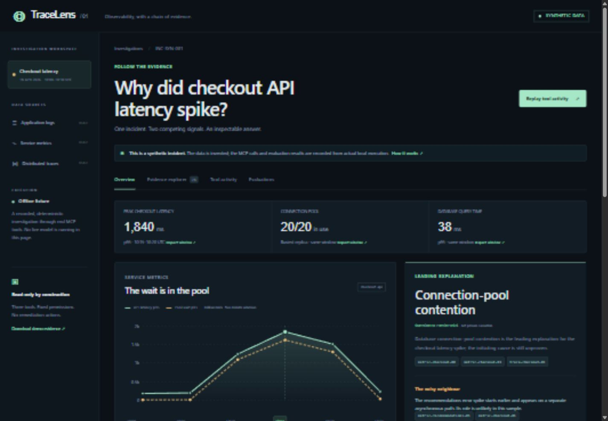
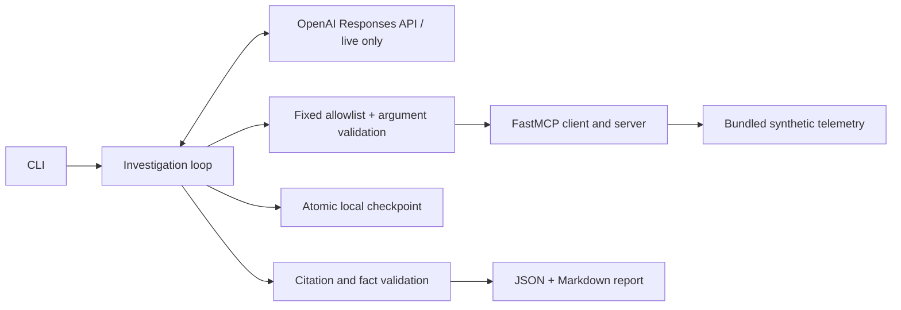

# TraceLens MCP

**Follow the evidence, then form a hypothesis.**

A small Python investigation agent backed by a read-only FastMCP server. It investigates **“Why did checkout API latency spike?”** using entirely **synthetic** production-shaped telemetry. Includes a browser demo with clickable citations, a metric timeline, tool activity replay and actual evaluation results.

**Source publication build; the web demo is not deployed.** The included report is a deterministic offline fixture, not a live LLM result. The live Responses API path is implemented and tested with scripted provider responses; an actual model run requires your API key. This is a portfolio project, not a production incident response service.



## Run in two minutes

Python 3.11+ (verified locally on Python 3.11). From this repository:

```sh
python -m venv .venv
# macOS / Linux:
source .venv/bin/activate
# Windows PowerShell instead:
# .venv\Scripts\Activate.ps1
python -m pip install -r requirements.lock
python -m pip install --no-deps -e .
tracelens investigate --mode fixture --scenario transient --run-dir runs/demo
tracelens demo
```

Open **http://127.0.0.1:8000** for the included recorded demo. It serves only the packaged web directory, not your run files or `.env`. The demo is static and never accepts API keys or calls a model. “Replay” reveals recorded events, not a simulated live investigation.

For a minimal install without the verification tools, `python -m pip install .` resolves the dependency ranges from `pyproject.toml`. The lock file records the versions actually installed during verification, with Windows-only dependencies marked accordingly.

## Live LLM investigation

Copy `.env.example` to `.env`, set `OPENAI_API_KEY`, and optionally set `TRACELENS_MODEL` to a Responses API model you can access (default: `gpt-4.1-mini`). The API can incur charges. Then:

```sh
tracelens investigate --mode live --scenario transient --run-dir runs/live
```

The model selects tools through function calling and writes a schema-constrained report. Every narrative item requires evidence references, and structured facts must exactly match retrieved record fields. Unknown references and mismatched facts reject the report. The model can correct a rejected report within the remaining round budget. There is no silent fallback to the fixture.

Only the synthetic question and retrieved telemetry are sent to OpenAI. Responses use `store=False`; this does not imply zero provider retention. Local progress contains tool results and the model conversation. Never commit a real run containing sensitive telemetry. The included examples contain only invented records.

## What the incident shows

The six UTC metric windows span **18 April 2026, 10:00–10:30**. Metrics describe the busiest checkout replica. In the example:

- Checkout p95 rises from **180 ms to 1,840 ms**: `metric-checkout-00`, `metric-checkout-03`.
- All **20/20** connections are occupied, with **1,620 ms** pool wait p95 and **38 ms** database query p95: `metric-checkout-03`.
- A sampled request waits **1,590 of 1,780 ms** to acquire a connection: `trace-checkout-03`.
- Recommendations errors reach **12.4%** before checkout slows, and a sampled failure belongs to an asynchronous refresh: `metric-recommendations-01`, `metric-checkout-01`, `log-recommendations-error`, `trace-recommendations-01`.

This supports connection-pool contention as the immediate bottleneck. It does **not** prove why connections were held or whether increasing the pool is safe. Five-minute aggregates and a handful of traces cannot establish universal dependency absence or causality.

Read [the complete example report](examples/recovery/report.md), [its evidence](examples/recovery/evidence.json), and [its execution checkpoint](examples/recovery/progress.json). Reference fragments in Markdown identify JSON keys; JSON viewers do not necessarily navigate to fragments. The browser demo provides working record navigation.

## Architecture



| Component | Responsibility |
| --- | --- |
| `server.py`, `telemetry.py` | Three bounded, read-only tools over bundled records |
| `gateway.py` | Model-independent permissions, input validation, caching, timeouts, retry budgets |
| `agent.py` | Live function-call loop, pending-call resumption, provider retry policy |
| `fixture.py` | Explicitly deterministic example plan and report, not a general reasoning engine |
| `report.py` | Typed claims, hypotheses, uncertainty, next steps and exact-value facts |
| `state.py` | Atomic JSON checkpoints; state is never an MCP tool |
| `web/` | Standalone recorded fixture explorer; no backend or external assets required |

The CLI uses FastMCP's in-memory transport. These are real MCP protocol calls, without a separately managed process. The standalone server also supports stdio, exercised by an integration test:

```sh
tracelens server
# Equivalent:
python -m tracelens server
```

A generic MCP client configuration (replace the executable path with your environment's Python):

```json
{"mcpServers":{"tracelens":{"command":"/absolute/path/to/.venv/bin/python","args":["-m","tracelens","server"]}}}
```

Inspect schemas and sample outputs without a model:

```sh
tracelens tools
tracelens tools --call query_logs
tracelens tools --call get_service_metrics
tracelens tools --call get_traces
```

All tools accept a fixed service enum, timezone-aware `start`/`end`, and `limit` (1–100). Windows are limited to one hour. Logs and traces use `[start,end)`; metric windows must be fully contained. Truncation is explicit. The data is a small fixture with no pagination or production query backend.

## Trust boundary and injection demonstration

`log-injection` embeds an adversarial user-agent asking the agent to grant admin permissions, invoke `run_shell`, delete audit logs, and blame the unrelated service. This text is always treated as telemetry. It is shown literally, never evaluated as code or rendered as HTML.

Security does not depend on the model obeying the prompt:

1. The gateway uses a code-defined immutable allowlist before dispatch.
2. Extra arguments (including permission claims) are rejected.
3. The MCP server registers only three read implementations. No shell, write, URL, arbitrary path, SQL or administrative tool exists.
4. A scripted adversarial model deliberately requests the forbidden tool after reading the injection. The test checks `PERMISSION_DENIED` and no dispatch. Direct requests to the MCP server for unknown tools also fail.

Tool `readOnlyHint` annotations document intent; they are not the security boundary. The model cannot modify host code, install tools or write the progress file. The host persists progress outside the model's tool surface. The synthetic one-shot fault changes an in-memory test counter, never telemetry.

This demonstrates a permission boundary, **not** proof that an LLM cannot be misled in its written diagnosis. Citation validation checks provenance and exact structured facts, not full semantic entailment. A false narrative attached to a real citation can still pass. Human review remains necessary.

## Failure recovery and persisted progress

```sh
tracelens investigate --mode fixture --scenario transient --run-dir runs/recovery
# Re-run the identical command to resume or return the completed result.
```

The first metrics call returns a structured `TEMPORARY_UNAVAILABLE` response; the second succeeds. The real example checkpoint records seven dispatch attempts for six successful queries. Progress is saved before each attempt and after each result. Completed queries are cached by canonical tool name and arguments. Pending live model tool calls are drained before the next provider request.

- Tool timeout: **5 s**; at most **2 attempts per distinct query**, **24 total dispatches**.
- MCP connection timeout: **10 s**; tool discovery: **5 s**.
- Model call timeout: **60 s** externally / **45 s** SDK; **2 attempts per round**, SDK retries disabled.
- At most **10 model rounds**, **4 calls per model response**; exponential-scale short bounded backoff (0.1/0.2 s).
- Only explicit transient responses or timeouts are retried for telemetry. Generic tool errors and bad arguments are not retried. Provider connection failures, rate limits and server errors have bounded retries.

Run identity includes mode, model, scenario and dataset hash. Changing these requires a new run directory. Atomic replace protects against partially written checkpoints; this is a **single-writer** local design, not a transactional distributed job system. Do not run two processes against the same directory. Crash windows can repeat a read or provider request; there is no exactly-once guarantee. Persisted attempts prevent a restart from resetting budgets. Exhausted runs require a new directory for a fresh attempt. `Ctrl+C` preserves the last checkpoint.

## Evaluations and reproducibility

```sh
python scripts/evaluate.py
# Rebuild the recorded example and static payload if changed:
tracelens investigate --mode fixture --scenario transient --run-dir examples/recovery
python scripts/export_demo.py
```

[Actual machine-readable outcomes](examples/evaluation-results.json) include each test name, status, duration, platform and execution time. Tests cover:

- Real in-memory and stdio MCP transport, bounded windows and read-only handlers.
- Every report claim citing observed evidence; unknown/unretrieved citations, missing citations, wrong mode and wrong exact fact values rejected.
- Amplified distractor errors and removal of pool evidence. These are deterministic fixture checks, not LLM reasoning scores.
- Malicious log instructions and a scripted provider attempting a forbidden call through the live orchestration loop.
- One-shot tool failure, timeout exhaustion, total call budget, cached partial progress, completed resume, and configuration mismatch.
- Live-loop report repair and provider timeouts with scripted test doubles.

**No live model quality score or production deployment is claimed.** Docker is supplied but was not executable on the build host. The evaluation report is explicit about both omissions. CI runs the suite on Python 3.11 and 3.12 after you push; no CI success is claimed in this review build.

Recreate the invented data with `python scripts/generate_data.py`. All timestamps and values are deterministic. Aggregates and trace samples are authored independently; do not calculate a service p95 from these few trace samples. There are no real customers, credentials or production logs in the fixture.

## Docker

```sh
docker build -t tracelens .
docker run --rm tracelens
# Persist a fixture investigation (create ./runs first):
docker run --rm -v "$(pwd)/runs:/runs" tracelens investigate --mode fixture --scenario transient --run-dir /runs/demo
# Browser demo:
docker compose up --build
```

The image runs as a non-root user. Bind-mounted directories must be writable by that user. On Linux, set appropriate ownership or use `--user "$(id -u):$(id -g)"` for a mounted run. The compose service exposes only the static demo at `127.0.0.1:8000`, with a read-only filesystem. For live mode, pass `--env-file .env` and the `investigate --mode live` arguments. Never bake `.env` into an image.

## Shareable link, after review

The static demo can be hosted on GitHub Pages, Cloudflare Pages or any static host by publishing **only `src/tracelens/web/`**. No build step, API key or Python server is needed for that recorded demo. A manually triggered [Pages workflow](.github/workflows/pages.yml) is included. Review first, push the repository, enable GitHub Pages with GitHub Actions as its source, then explicitly run “Publish recorded demo”. A workflow run is required to publish the recorded demo website.

A public static link shows the recorded investigation and evaluations. Running a live LLM agent requires the CLI or a separately secured backend; it must never expose the API key in browser JavaScript.

## Limitations and scope

One authored incident, seven sampled traces, two services, six metric windows per service. No production collector integration, auth service, incident ticketing, automated remediation, streaming ingestion or multi-user orchestration. There is no statistical causal inference. The fixture report deliberately has a narrow scope and fixed scenario-specific interpretation. The LLM can still misread evidence. Read-only tools limit action authority but do not guarantee epistemic accuracy. The local demo HTTP server is for preview; use a static host for public sharing.

## References

Implementation follows [FastMCP client documentation](https://gofastmcp.com/clients/client), [tool calling](https://gofastmcp.com/clients/tools), and [OpenAI function calling](https://developers.openai.com/api/docs/guides/function-calling). The installed package versions are captured in `requirements.lock`.

MIT licensed. See [LICENSE](LICENSE).
